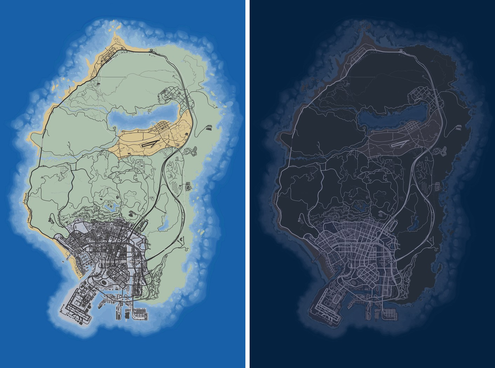
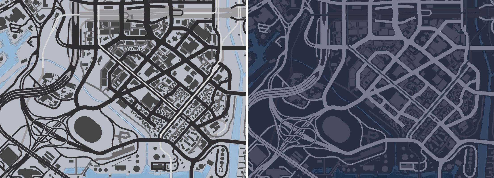

# FiveM Day/Night Gen7 style map

The **Remastered Gen7 Minimap** on FiveM's big (pause) map and radar, with a
**night version** that takes over after dark.

## Credits

**The map is not ours.** The map art (its colours and its remade 2D
textures) is the work of **Alex106**, from his
**[Remastered Gen7 Minimap](https://www.gta5-mods.com/misc/nxg-radar)** (v3.5) for
GTA V. Please download, endorse and rate it there. All credit for how the
map looks by day goes to him.

Alex106 in turn thanks:
- [dexyfex](https://www.gta5-mods.com/users/dexyfex) for CodeWalker, which the build tool here uses too
  ([CodeWalker on GitHub](https://github.com/dexyfex/CodeWalker))
- [the OpenIV Team](https://www.gta5-mods.com/users/GooD-NTS) for OpenIV
- [3Doomer](https://www.gta5-mods.com/users/3Doomer) for GIMS Evo

GTA V and its map belong to Rockstar Games.

What this repo adds on top of Alex106's map:
- a FiveM resource that streams it;
- the 2D tiles redrawn at 3072, with the mod's own vector detail drawn in, so
  it stays sharp zoomed in (his colours, matched exactly);
- a night version made from it, swapped in by the game clock.

## Install

1. Drop the `gen7_map` folder into your `resources` and `ensure gen7_map`.
2. Make sure no other resource streams `minimap_*.ytd` (another map mod);
   two resources streaming the same tile names fight over them.
3. Restart the server. Don't start it while players are connected:
   streamed map assets loading mid-session can crash clients.

The big map shows these 2D tiles while zoomed out. Zoomed in, the game normally
switches to its own vector map, which doesn't change with this resource and
doesn't go dark at night. To keep the 2D tiles at every zoom, also stream empty
vector tiles (`minimap_<x>_<y>.ydd`). The postal map **ls_map_lite** does this,
and this resource was built to run alongside it.

## Day and night

- **Day:** Alex106's Gen7 look.
- **Night:** the same map gone dark: slate ground, light roads, buildings in
  between, dark navy water (the night palette of the
  [vice_hud](https://github.com/Geckomacabre/GTA-VI-UI-and-HUD-for-FiveM) 3D minimap).
- It changes over at **20:15** and **05:45** game time (`config.lua`).
- `/mapmode auto | day | night`: each player can keep one map all the time;
  their choice is kept between sessions.

## How the night swap works

`stream/gen7night_*.ytd` are drawn in place of the day tiles with
`AddReplaceTexture`. FiveM ties that swap to the texture the game has loaded
at that moment, and the game drops map tiles and loads them again as it
needs them. That's why map swaps elsewhere "revert after a while". While it's
night this resource holds every tile (day and night, about 170 MB of video
memory) so none can reload; by day it holds nothing.

The open sea beyond the coast's shading isn't in the tiles at all: it's the
`HUD_COLOUR_PAUSEMAP_TINT` colour, which is set navy at night
(`Config.NightSeaTint`).

`AddReplaceTexture` is marked experimental in FiveM's docs.

## Rebuilding

Never hand-edit `stream/`. It's built by `tools/` (`python build.py`) from
Alex106's download, which also draws the previews. The night colours are in
`tools/nightcolor.py`. See `tools/README.md`.

## Status

Built and checked without the game: the tiles round-trip through CodeWalker,
`tools/check_client.lua` runs the client on a mock (26 checks) and
`tools/mutate.py` breaks it 16 ways (all caught). Still to be confirmed in game:
- that the swap shows on the big map and stays put through a night;
- how the open sea looks against the pause menu's backdrop, day and night;
- the zoomed-in views.
